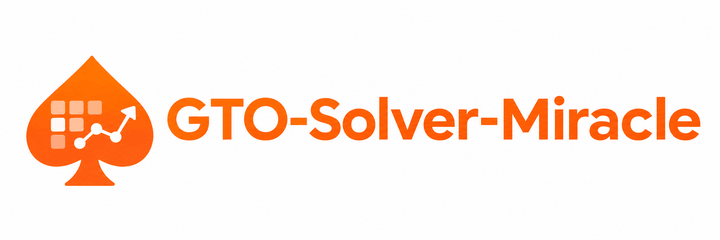

GTO Solver Miracle ♠

An interactive Texas Hold’em study platform for practicing decisions, reviewing hands, exploring equity, and comparing solver-backed strategies with explicit opponent assumptions.

Built with Next.js, React, TypeScript, Python, FastAPI, and PostgreSQL.

> **Project status:** Actively developed. Miracle offers a playable training table, hand analysis, equity tools, and a catalog of reviewed, bounded solver scenarios. It is **not** a general-purpose solver for every possible no-limit Hold’em game state, and the repository does not currently advertise a verified public demo URL.

What you can do

|Workspace                      |Capabilities                                                                                                                                                 |
|-------------------------------|-------------------------------------------------------------------------------------------------------------------------------------------------------------|
|**Study** (`/`)                |Explore a 169-hand starting-range matrix, edit weighted ranges, inspect blockers and board context, calculate equity, and query supported strategy scenarios.|
|**Poker Trainer** (`/trainer`) |Play complete six-player hands against five automated opponents, choose legal actions and bet sizes, and review completed hands.                             |
|**Hand Analyzer** (`/analyzer`)|Enter or replay six-player hands, inspect decision history, calculate equity, and compare available solver and opponent-model analyses.                      |
|**Player Account**             |Use guest mode or configure Google sign-in and PostgreSQL-backed private training records and imports.                                                       |

Strategy and opponent modeling

• Inspect reviewed solver-generated river decisions with mixed action frequencies, combination-level strategy, chip EV, and reported solution accuracy.
• Explore a bounded joint turn-to-river CFR+ scenario across legal river runouts.
• Compare equilibrium baselines with best responses to explicitly defined opponent policies on supported decisions.
• Inspect replay-derived opponent observations, uncertainty, and provisional player archetypes.
• Configure heuristic opponent styles in the trainer, including tight/aggressive and loose/passive profiles. A “Standard GTO” trainer bot label is not a claim that the bot is solver-optimal.

Equity and hand evaluation

• Calculate hand-versus-hand, hand-versus-weighted-range, and range-versus-range showdown equity.
• Use exact enumeration for smaller cases or bounded seeded Monte Carlo sampling for larger cases, with uncertainty estimates where applicable.
• Evaluate seven-card hands, ties, side pots, all-ins, and chip payouts through the independent rules engine.
• Interpret pot odds under the tool’s displayed assumptions; showdown equity is not the same as a complete action EV calculation.

Architecture

Browser (Next.js / React / TypeScript)
            |
            | same-origin application routes
            v
Next.js server / API proxy
            |
            v
FastAPI (Python)
    |-- No-limit Hold'em rules and hand evaluator
    |-- Equity and bounded strategy/solver analysis
    |-- Training sessions and opponent observations
    `-- Optional authenticated account storage (PostgreSQL)

The backend owns game state and card secrecy; the frontend renders only authorized public state. The repository also contains Docker Compose configuration, automated tests, CI workflows, and detailed technical documentation.

Run locally

Prerequisites: Python 3.12+, Node.js 24, and npm. Commands below use PowerShell on Windows; on macOS/Linux replace .\.venv\Scripts\python.exe with .venv/bin/python.

Clone the project and install dependencies:

git clone https://github.com/DongtaiHuang/GTO-Solver-Miracle.git
cd GTO-Solver-Miracle
python -m venv .venv
.\.venv\Scripts\python.exe -m pip install -e './backend[dev]'
npm ci

Start the backend in one terminal:

.\.venv\Scripts\python.exe -m uvicorn poker_lab.api:app --host 127.0.0.1 --port 8000 --reload

Start the frontend in another terminal from the repository root:

npm run dev

|Local URL                       |Purpose              |
|--------------------------------|---------------------|
|`http://localhost:3000`         |Study workspace      |
|`http://localhost:3000/trainer` |Poker Trainer        |
|`http://localhost:3000/analyzer`|Hand Analyzer        |
|`http://localhost:8000/health`  |Backend health check |
|`http://localhost:8000/docs`    |FastAPI API reference|

Guest mode does not require PostgreSQL. For account persistence, configure the Google OAuth client and database environment variables using .env.example, then follow the account setup guide and the deployment/recovery guide if those are the current filenames in your checkout.

Docker

For the base development stack:

docker compose up --build --wait
docker compose down

The base Compose configuration binds frontend and backend ports to 127.0.0.1; it does not publish Miracle on the internet. Account mode uses the separate compose.accounts.yaml overlay and additional configuration. Do not expose development defaults directly to the public internet.

Quality and verification

The project includes Python unit/integration tests, frontend component tests, TypeScript checks, linting, browser-level tests, and CI automation.

cd backend
..\.venv\Scripts\python.exe -m pytest
..\.venv\Scripts\python.exe -m ruff check .
..\.venv\Scripts\python.exe -m mypy
cd ..
npm test
npm run typecheck
npm run build

For Playwright end-to-end testing, install Chromium and follow the browser-test setup described in the repository’s technical documentation, then run npm run test:e2e.

The poker engine tests cover legal action enforcement, betting rounds, short raises, side pots, ties, showdown evaluation, deterministic scenarios, and chip conservation. Passing software tests does not establish that every solver strategy is globally optimal.

Security and data boundaries

• Training hands are owned by server-managed sessions, with opaque HttpOnly cookies and stale-action revision checks.
• Hidden opponent cards remain private until the rules permit disclosure.
• Optional account mode provides private records through Google sign-in and PostgreSQL.
• Local administrative strategy imports and private catalogs should remain outside version control.
• Production hosting requires HTTPS, secure cookies, correct allowed hosts/origins, persistent database storage, and deployment-specific validation.

Scope and limitations

Miracle’s solver-backed comparisons are available only for explicitly supported and reviewed scenarios. The interface should show when no validated strategy exists rather than fabricate GTO frequencies or EVs. Opponent models rely on observed data and assumptions; their classifications and exploitative recommendations are conditional, not guaranteed predictions. The training opponents are heuristic bots, not a live multiplayer poker service. Guest-session state may be lost on backend restart.

Miracle is intended for poker education and software research, not real-money gambling or guaranteed financial outcomes.

Technical documentation

Detailed methodology, validation, and reproduction instructions are kept separately so this README stays approachable:

|Area                                                |Reference                                                                                                       |
|----------------------------------------------------|----------------------------------------------------------------------------------------------------------------|
|Rules engine, trainer, equity and strategy dashboard|[`docs/`](docs/) — Tasks 001–005                                                                                |
|River solving and opponent-specific responses       |[`docs/TASK006A.md`](docs/TASK006A.md), [`docs/TASK006B.md`](docs/TASK006B.md)                                  |
|Hand history analyzer                               |[`docs/TASK007.md`](docs/TASK007.md)                                                                            |
|Expanded river and multi-street strategy            |[`docs/TASK008.md`](docs/TASK008.md), [`docs/TASK009.md`](docs/TASK009.md), [`docs/TASK011.md`](docs/TASK011.md)|
|Adaptive opponent observations                      |[`docs/TASK010.md`](docs/TASK010.md)                                                                            |
|Account and deployment configuration                |See the account/deployment guides in [`docs/`](docs/)                                                           |

Roadmap

Potential next steps include broader reviewed solver coverage, richer coaching and hand-review workflows, and a production-ready public deployment. These are directions, not promises of completed functionality.

License

Released under the MIT License.
