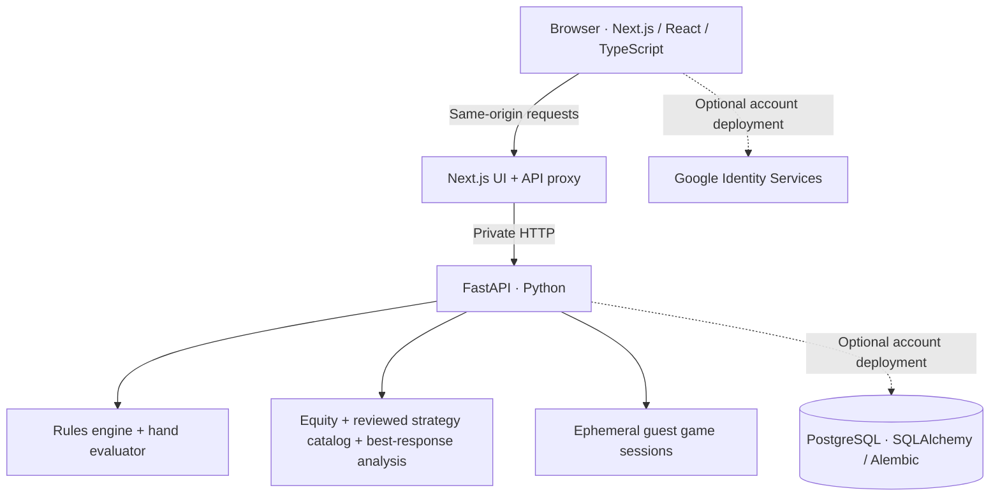

<div align="center">


# MIRACLE — Poker Strategy Lab

**Play hands. Explore ranges. Review decisions. Practice with solver-backed feedback.**

[**Try the live demo**](https://miracle-poker-demo.onrender.com) · [Features](#features) · [Run locally](#run-locally) · [Technical documentation](#technical-documentation)

</div>

MIRACLE is an open-source, full-stack **Texas Hold'em education and strategy research project**. It combines an interactive six-seat poker trainer, showdown equity tools, hand-history replay, opponent observations, and a curated library of mathematically reviewed GTO scenarios.

**The public demo is free and guest-only:** no sign-up, Google account, paid subscription, or database is needed to try the four main workspaces. The codebase also includes an **optional** Google-authenticated PostgreSQL account mode for private saves; this is **not enabled on the free public demo**.

> **Solver scope:** MIRACLE is **not** a general-purpose GTO solver for arbitrary six-max hands. Solver frequencies, action EVs, and exploitative responses are available only for the explicitly reviewed, supported scenarios. The application labels unsupported situations rather than inventing advice.

## Live demo

**Website:** https://miracle-poker-demo.onrender.com

Open the site and choose **Study**, **Trainer**, **Hand Analyzer**, or **Training Center** from the navigation.

The demo is deployed on a **Render Free** Docker web service with a public Next.js frontend and a private FastAPI backend running in the same container. Free instances may sleep after inactivity; the first visit after a sleep can take a minute or longer. Active Trainer hands can be lost on restart, and tab-local practice/history data is **not** cloud-synced. Export any history you want to keep. No real-money wagering or multiplayer service is provided.

## Features

| Workspace | What you can do |
| --- | --- |
| **Study** · [`/`](https://miracle-poker-demo.onrender.com/) | Explore a **169-hand** starting-range matrix, edit weighted ranges, inspect blockers and board context, calculate showdown equity, and query supported solver decisions. |
| **Trainer** · [`/trainer`](https://miracle-poker-demo.onrender.com/trainer) | Play complete **six-player no-limit Hold'em** hands against five configurable **heuristic** opponents; review legal actions, bets, side pots and settlement. |
| **Hand Analyzer** · [`/analyzer`](https://miracle-poker-demo.onrender.com/analyzer) | Enter, import, validate and replay hand histories; examine decision sequences, equity and available solver/model comparisons. Review a finished Trainer hand. |
| **Training Center** · [`/training`](https://miracle-poker-demo.onrender.com/training) | Practice **37 reviewed decision records**, compare your choice with equilibrium or an explicitly modeled opponent, inspect action-EV loss, retry and review weaknesses. |

Additional capabilities:

- **Equity:** hand vs. hand, hand vs. weighted range, and range vs. range; exact enumeration for small cases and bounded seeded Monte Carlo for larger cases, with uncertainty estimates where applicable.
- **Opponent modeling:** editable TAG, LAG, tight-passive and loose-passive assumptions, plus opportunity-based statistics and uncertainty estimates derived from reviewed hands.
- **Exploitative analysis:** compare a reviewed equilibrium baseline with a calculated best response against a specified conditional opponent policy. These conclusions depend on the modeled policy.
- **Verified poker mechanics:** integer-chip accounting, betting-round rules, all-ins, side pots, odd-chip splits, showdown ties and hidden-card protection.
- **Practice history:** browser-tab storage and JSON export/import in guest mode; optional owner-scoped PostgreSQL storage in a separately configured account deployment.

### What “GTO” means here

The bundled catalog contains **37 reviewed decision records**: **4** restricted river records (Task 006A), **5** expanded river records (Task 008), and **28** published turn-to-river decisions (Task 009). The bounded turn-to-river CFR+ game covers its legal river continuations, while only selected decision records are published in the interface. Its exact abstraction fixes ranges, board context, action sizing and other game-tree assumptions.

A strategy's **mixed frequencies**, **showdown equity**, **equilibrium action EV**, **model-conditioned best response**, and **realized hand results** are different quantities. MIRACLE keeps these distinctions explicit. Trainer opponents are **heuristic bots**, not equilibrium-playing agents; a “Standard GTO” profile label should not be taken as a solver-backed bot guarantee.

See [turn-to-river solving](docs/TASK009.md), [opponent-specific best response](docs/TASK011.md), and [practice grading](docs/TASK012.md) for methods, provenance and limitations.

## Architecture



**Technology:** Next.js 16, React 19, TypeScript, Python 3.12+, FastAPI, PostgreSQL 16 for optional private accounts, SQLAlchemy, Alembic, Docker, GitHub Actions, pytest, Vitest and Playwright. CFR+ and numerical/equity tooling run in Python.

The backend owns game state, the deck and unrevealed cards. Next.js serves the interface and proxies requests; it does not expose a separate public FastAPI port in the guest deployment.

## Run locally

**Requirements:** Python 3.12+, Node.js 24, npm. PowerShell commands are shown below. On macOS/Linux use `.venv/bin/python` instead of `.\.venv\Scripts\python.exe`.

```powershell
git clone https://github.com/DongtaiHuang/GTO-Solver-Miracle.git
cd GTO-Solver-Miracle
python -m venv .venv
.\.venv\Scripts\python.exe -m pip install -e './backend[dev]'
npm ci
```

Start the backend from the repository root:

```powershell
.\.venv\Scripts\python.exe -m uvicorn poker_lab.api:app --host 127.0.0.1 --port 8000 --reload
```

In **another terminal**, from the same repository root:

```powershell
npm run dev
```

Then open:

| URL | Purpose |
| --- | --- |
| http://localhost:3000 | Study |
| http://localhost:3000/trainer | Trainer |
| http://localhost:3000/analyzer | Hand Analyzer |
| http://localhost:3000/training | Training Center |
| http://localhost:8000/health | FastAPI health |
| http://localhost:8000/docs | API documentation |

These commands run the standard local development configuration; the separate Render guest build sets its guest-mode flags at build/startup. **The standard local guest workflows do not require PostgreSQL or Google credentials.**

### Docker and deployment

Run the base development Compose stack:

```sh
docker compose up --build --wait
docker compose down
```

The base stack binds application ports to localhost; **do not expose development settings directly to the internet**.

The free deployed demo uses [`render.yaml`](render.yaml), [`Dockerfile.demo`](Dockerfile.demo) and [`tools/start_guest_demo.py`](tools/start_guest_demo.py). The Render Blueprint defines **one Free web service**, no disk or database, with `/api/health` as its health check; auto-deploy is disabled, so updates require a manual deployment or Blueprint sync. For detailed steps, diagnostics and sleep/wake limitations, read [the Task 014D deployment guide](docs/TASK014D.md).

The optional account-enabled stack uses `compose.accounts.yaml`, PostgreSQL and a configured Google web client. Its security, migrations and recovery requirements are documented in [Task 013](docs/TASK013.md), [Task 014A](docs/TASK014A.md) and [Task 014B](docs/TASK014B.md). **These accounts are not part of the free demo.**

## Tests and quality

The project includes poker-rule tests, PostgreSQL integration tests, numerical regression tests, frontend unit/component tests, browser end-to-end tests, and Docker smoke tests.

Run the checks **sequentially** if your computer has limited memory:

```powershell
# From repository root
.\.venv\Scripts\python.exe -m pytest backend/tests
.\.venv\Scripts\python.exe -m ruff check backend
# Run mypy from backend if using the project configuration
cd backend
..\.venv\Scripts\python.exe -m mypy
cd ..

npm test
npm run typecheck
npm run build

# Numerical solver tests
.\.venv\Scripts\python.exe -m pytest -q tools

# Browser acceptance tests (after installing Playwright Chromium)
npm run test:e2e
```

PostgreSQL-backed account tests require an appropriately configured **disposable** test database. Browser tests require Playwright Chromium and their documented test environment. GitHub Actions additionally verifies backend/frontend builds, numerical results, browser flows, base Docker, account infrastructure and the **guest-demo Linux container under a 512 MiB memory limit**.

For historical test evidence and release limitations, see [Task 014C QA](docs/TASK014C.md) and [release checklist](docs/RELEASE_V1.md). Successful unit tests do not prove that arbitrary poker states have optimal strategies.

## Security, privacy and limitations

- **Guest demo:** no login, paid plan or server-side cloud saves. In-memory live hands can reset when the free host sleeps/restarts. Tab-local archives are not automatically shared across devices; export JSON to retain a portable copy.
- **Cards and sessions:** the backend keeps private deck state and unrevealed opponent cards server-side. Guest hands use session cookies and stale-action checks.
- **Strategy boundaries:** a limited reviewed solver library does not cover arbitrary hands, boards, bet sizes or opponent ranges. Unsupported comparisons are clearly marked.
- **Opponent inference:** labels, Bayesian estimates and exploitative responses describe evidence and specified assumptions—not certainty about a real player.
- **Optional private accounts:** separately configured Google token verification, revocable sessions, owner-scoped database records and recovery procedures exist in source but are **disabled** on the free hosted demo.
- **Purpose:** education, software engineering and game-theoretic research—not real-money gambling, guaranteed winnings or professional betting advice.

## Technical documentation

| Topic | Reference |
| --- | --- |
| Poker engine, Trainer, equity and early Study design | [`docs/`](docs/) · Tasks 001–005 |
| Restricted river solutions | [Task 006A](docs/TASK006A.md), [Task 006B](docs/TASK006B.md), [Task 008](docs/TASK008.md) |
| Hand History Analyzer | [Task 007](docs/TASK007.md) |
| Turn-to-river CFR+ solution | [Task 009](docs/TASK009.md) |
| Adaptive opponent observations | [Task 010](docs/TASK010.md) |
| Multi-street exploitative analysis | [Task 011](docs/TASK011.md) |
| Training Center and EV grading | [Task 012](docs/TASK012.md) |
| Authenticated storage and security | [Task 013](docs/TASK013.md), [Task 014B](docs/TASK014B.md) |
| Persistence and recovery | [Task 014A](docs/TASK014A.md) |
| Branding, accessibility and UI QA | [Task 014C](docs/TASK014C.md) |
| Free Render deployment and release checklist | [Task 014D](docs/TASK014D.md), [Release V1](docs/RELEASE_V1.md) |

## Project status and future work

**Current:** Public, free guest demo deployed; source also supports a separately configured authenticated deployment. The public demo has been visually verified in a browser; comprehensive independent live acceptance, load testing and physical-device accessibility checks are not claimed here.

Potential future improvements include broader mathematically reviewed game-tree coverage, richer coaching and replay workflows, and more scalable session hosting. These are roadmap ideas, **not** current capabilities.

## License

Licensed under the [MIT License](LICENSE). © 2026 DongtaiHuang.
