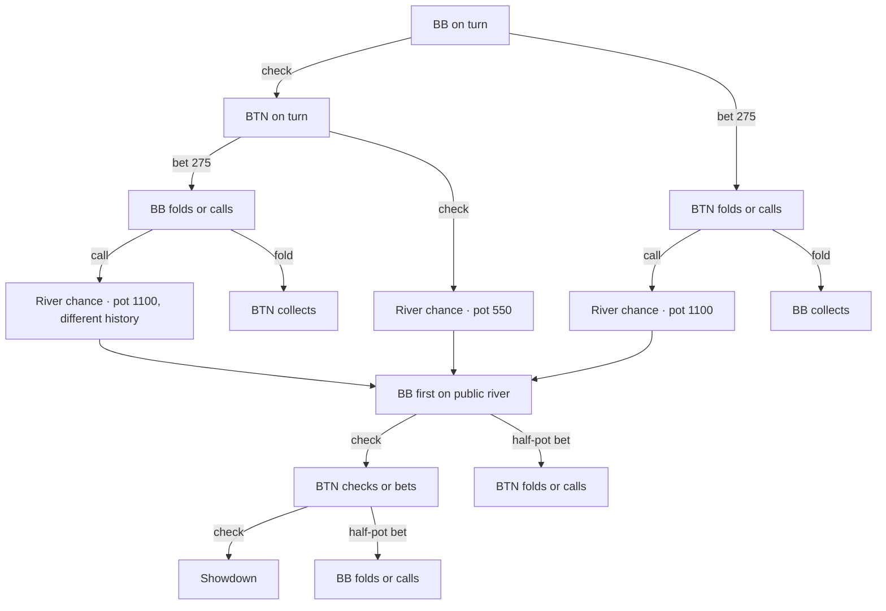

# Task 009 — Joint turn and river equilibrium

Choose **ts-root-v1** in Study and query the exact scenario. BB acts first on Kd 7h 2s Tc. Turn action EV includes the cost of that action, the conditional river distribution and future decisions by both players. Select e.g. **ts-check-check-9d-v1** and **ts-check-check-As-v1** to inspect BB's continuation after the same turn line on different public cards.

## Restricted game

Six starting stacks of 10,000 chips; blinds 50/100. UTG, HJ, CO fold, BTN opens to 250, SB folds, BB calls 150. Both check the flop. No antes or rake. On the turn the pot is 550 and each live player has 9,750 behind. Use the eight weighted private combos per side from tools/expanded_ranges.json, with weights interpreted as assumptions conditional on reaching this turn. No preflop or flop strategy is inferred.



Each river bet is 275 or 550 according to its incoming pot. Each call goes to showdown and each fold terminates immediately. The diagram shares the river action pattern for readability; the solver stores separate policies for all three incoming histories. Raises and all-ins lie outside this abstraction.

## Chance, information and optimization

The initial joint deal mass is proportional to BTN weight × BB weight for disjoint hands. Board conflicts are rejected. Normalize the remaining 60 deal masses to sum to one. For a given deal, each of 44 river cards has probability 1/44. Forty-eight board-compatible public river labels occur across deals. A private card blocks that river only for deals containing it. The joint river tensor is the product of deal mass and this conditional probability. It contains 2,640 nonzero entries.

Keys distinguish public action sequence, acting seat, street, public river (if dealt), and the actor's own combo. Public history determines pot, investment and legal actions. All compatible opponent combos share the same strategy row. The implementation vectorizes public river outcomes but sums their conditional continuation values **before** computing a turn action advantage. A turn row has no river-card index to select.

The offline trainer uses exhaustive alternating CFR+ with Task 008 regret matching. Each iteration updates BTN then BB using the updated BTN policy. At each information set, sum signed root-relative action utilities over hidden hands weighted by chance and opponent realization probability. Subtract the current mixed value and clip cumulative regret at zero. The exported policy normalizes the linear average accumulated with iteration × own reach. Exported combo reach includes joint chance and both realization probabilities; combos with zero node mass are omitted.

For matched total postflop investment x beyond the initial pot and showdown share s, BTN receives s(550+2x)−x. BB receives 550 minus BTN utility. A fold awards the pot to the bettor, net of that player's additional investment. At a decision, exported action EV adds back the actor's sunk investment and divides counterfactual values by the compatible chance/opponent reach mass. Fold EV therefore equals zero when facing a bet. Checking on a free action weakly dominates folding; the dataset includes a legal zero-frequency free fold with zero EV for schema compatibility.

## Independent accuracy check

The best-response evaluator uses a separate backward induction routine with no regret or strategy-average updates. At terminals it integrates the responder's own chip utility over opponent hands with opponent policy reach and joint chance. At opponent nodes it sums policy-weighted branch contributions; at responder nodes it maximizes per own combo. Chance nodes sum the already chance-weighted river values before returning to a turn decision. Tests exercise a known drawing-dead matchup, best-response values against uniform play, chance normalization, and the improvement from uniform to trained play.

| Iterations | Average BTN EV | BTN best response | BB best response | Full gap (chips) | Cumulative seconds |
|---:|---:|---:|---:|---:|---:|
| 10 | 253.242494 | 280.816434 | 334.273747 | 65.090180 | 0.10 |
| 100 | 252.870269 | 253.360297 | 297.932528 | 1.292825 | 0.37 |
| 500 | 252.802303 | 252.841611 | 297.271682 | 0.113293 | 1.61 |
| 1,500 | 252.798054 | 252.807639 | 297.214852 | **0.022491** | 5.68 |

Both BR columns use the respective player's chip utility. The average pair splits the original 550 chips in expectation. The full unilateral-deviation gap is BTN BR + BB BR − 550. At 1,500 iterations the half-gap exploitability convention gives 0.011246 chips. The export gate requires the measured full gap ≤1 chip and each best response to attain at least its baseline value within floating-point tolerance. These numerical measurements apply to the stated finite game and weighted ranges.

## Resource bounds and reproduction

The fixed tree contains 4,448 legal private/public information sets and 39,720 compatible deal-terminal states, reused on every pass. Showdown hand ranks, the river mask and terminal payoffs are cached. Limit each range to 16 combos and a run to 4,000 iterations. The generator performs a one-iteration allocation probe covering construction, training, policy reporting and best response, and rejects a traced peak over 64 MiB. It measured 1,278,007 bytes on the first local run. This is traced working memory, not a process RSS ceiling. The runtime column includes construction, training and convergence checks, excluding the memory probe and export; timings vary by machine.

With the backend installed in a Python 3.12 environment and the Task 008 offline dependencies (NumPy 2.4.6 and SciPy 1.15.3), run from the repository root:

```sh
python -m pytest -q tools
python tools/solve_turn.py --verify
```

Without --verify the generator writes fresh UTC timestamps. Verification rebuilds the complete records using their saved timestamp and compares numerical output and approval hashes in the same numerical environment. Normal Study and Analyzer requests read validated records only.

## Published coverage

The Task 005 version 1.0 envelopes in backend/src/poker_lab/data/turn_river_v1.json publish four turn decisions plus 24 river decisions (three turn lines × two public rivers × four decision nodes). The offline solve includes every legal river, while the published river subset is 9d and As. IDs encode the public path; the canonical scenario includes the exact board, ordered actions, positions, stacks, range identifier, and half-pot tree/chance assumptions. Hand Analyzer offers corresponding exact abstractions at matching public decisions. Old river abstractions retain their own identifiers. Task 006B modeled best responses remain available only for their previously verified trees.
