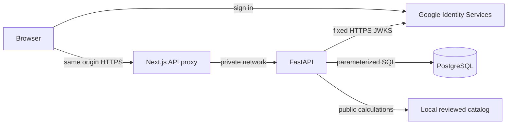

# Private account storage



Guests can continue using Study, Trainer, Analyzer and Training Center. Live games remain in the existing ephemeral Trainer session store. A completed Trainer review carries only the cards permitted by its existing view. Private saves never serialize engine state, seeds or deck order.

## Identity and deployment

In Google Cloud Console, select a project, configure **Google Auth Platform → Branding, Audience and Clients**, add test users for a testing audience, create a **Web application** OAuth client and register the exact frontend origin as an **Authorized JavaScript origin**. Use http://localhost:3000 for local review and the public HTTPS origin for production. Set GOOGLE_CLIENT_ID on FastAPI to the generated web client ID. The popup credential flow needs no client secret or redirect endpoint. Configure provider publication/verification as required by the audience. See [Google's web client setup](https://developers.google.com/identity/gsi/web/guides/get-google-api-clientid).

The account page loads Google's official client on user request. FastAPI issues a five-minute random browser challenge and verifies the RS256 ID token against Google's HTTPS signing keys, the configured audience, issuer, subject, expiration and challenge nonce. The stable identity is (issuer, subject); verified email is optional. Successful login rotates the opaque secret and stores only its digest, with an eight-hour expiry. Sign-out revokes the current server session. Browser script does not store credentials. Google provider sessions can outlive MIRACLE logout. Account deletion cascades through all private records and sessions.

Deploy one Next.js container behind a trusted HTTPS ingress, one private FastAPI container, and a managed PostgreSQL database on a private network. Keep one backend instance for live Trainer sessions or use sticky routing with documented ephemeral loss on restart. Enforce TLS, upstream host restrictions, body and concurrency limits, and per-client authentication rate limits at the ingress. The backend caps outstanding challenges at 256 and expires them after five minutes. Private mutations require JSON, an exact matching Origin and SameSite cookies. Access logs should omit query strings and bodies, credentials and cookies. Database failures log a structured event without SQL parameters. Expose Next.js only; protect database and backend ports with network rules. CROSS-ORIGIN resource sharing is unnecessary.

## Setup and operations

Copy .env.example to .env. Set POSTGRES_PASSWORD to a unique local password and DATABASE_URL to postgresql+psycopg://miracle:<percent-encoded password>@db:5432/miracle. Use the managed provider's TLS settings in production. Set TRAINER_ORIGIN to the exact public origin, COOKIE_SECURE=true for HTTPS, ALLOWED_HOSTS to allowed backend request hosts, and BACKEND_URL for Next.js to the private backend address. Leave credentials in the deployment secret manager. Guest-only compose.yaml remains supported.

```sh
docker compose -f compose.yaml -f compose.accounts.yaml up --build -d
docker compose -f compose.yaml -f compose.accounts.yaml logs migrate
```

For the native backend, install backend[dev], provide DATABASE_URL in the environment, then run `alembic upgrade head` from backend. Alembic revision 001_accounts creates members, logins, challenges, saved_hands, opponent_archives, practice_sessions and practice_attempts. Composite owner/record keys isolate reusable IDs. Cascading foreign keys enforce session ownership. Each instance has four pooled connections plus two overflow, a three-second checkout timeout and an eight-second SQL statement timeout. SQLAlchemy runs parameterized transactional Core statements. Commit failure must fail the request. Migration runs as a separate job before accepting account traffic. GET /health probes the process; GET /ready checks the expected database revision. Guest computations do not depend on readiness of the database.

Use managed encrypted snapshots with point-in-time recovery plus periodic custom-format logical backups. Provide libpq credentials using a secret-mounted service/password file. Run `pg_dump -Fc --file=miracle.dump --dbname=service=miracle` to protected storage; retain under the operator's retention policy. Restore into a separate empty database with `pg_restore --exit-on-error --single-transaction --no-owner --dbname=service=restore miracle.dump`. Check revision, run migration and test ownership and record counts before switching traffic. Roll back failed deployment by restoring the last compatible service image and database copy; retain the old database until verification. A restore can reinstate historical sessions; revoke restored logins and challenges before reopening access.

## Personal data APIs and UI

All paths below use /api/account. The authenticated owner comes from the session cookie. Missing and foreign object IDs have the same response. List hands and sessions using offset, 50 per page. Session reads return up to 64 attempts per page.

| Resource | Operations |
|---|---|
| Identity | POST challenge, login, logout; GET me; POST delete with confirm=true |
| Analyzer | POST hands, GET hands, GET hands/{id}, POST hands/{id}/update or /delete |
| Observations | GET observations, POST observations with revision and archive |
| Practice | POST training, GET sessions and sessions/{id}, POST attempts/{id}/delete, sessions/{id}/delete or training/clear |

Use **Player account** to import named Analyzer tab saves and open saved records directly in Analyzer. Title, source labels and source hand IDs provide attribution rather than proof of a third-party hand's authenticity. Account records are private. Saved hands undergo full replay, including settlement checks. Observation writes validate Task 010's evidence, mappings and overrides. Loading an archive into the tab or replacing a server archive requires explicit confirmation. Edit/delete opponents or reset using the existing observation panel, then submit the revised archive. A stale write returns 409. Export both copies and reconcile before replacement.

Training imports atomically add attempts. An identical stored ID is a no-op; different content under that ID rejects the batch. New attempts reproduce the original source and grade through Task 012. Reads export the stored original, including policy assumptions, source hash, feedback and retry identity. A missing original source prevents importing a new unverifiable score. Historical server exports remain readable. Use the Account page to merge attempts and browse, export or continue a session. The bounded tab format still applies. Synchronization is user-initiated, and sign-out leaves original tab-local data in place. On shared devices clear those copies separately. No public data sharing or automatic profile merging is provided.

## Verification

Set TEST_DATABASE_URL to a disposable PostgreSQL database. From backend run pytest, ruff check . and mypy. The PostgreSQL tests apply the production migration and exercise actual transactions and signed RSA test tokens. Only the provider signing-key fetch is replaced in tests. The GitHub backend job provisions a PostgreSQL service. Run the numerical tests and frontend/browser suites as documented in README. A live Google client, public DNS/TLS, provider-side identity revocations, backup recovery drills and deployment-provider configuration require operator verification. No hosted environment is provisioned by this repository.
