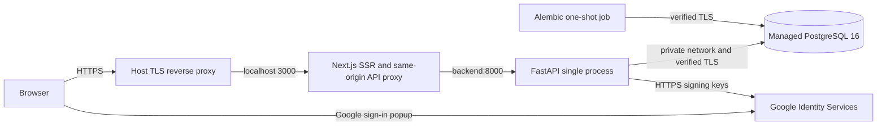

# MIRACLE release preparation

Stage 1 is a local release candidate. The following deployment commands are for the operator **after Stage 2 approval**. No provider account, live URL, billing commitment or public release is evidenced by this document.

## Current release target: free guest demo

Give visitors one provider-issued HTTPS URL for Study, Trainer, Analyzer and Training Center. Visitors play immediately without registering. Keep browser-tab saves and JSON export; omit cloud saves, the account sign-in prompt, managed PostgreSQL, migrations, a purchased domain and Google Cloud setup from this demo.

Proposed hosting: one Render Free Docker web service running Next.js on the assigned public port and FastAPI on loopback behind the existing proxy. Use one service to share a single wake cycle and instance-hour allocation. The operator needs a free hosting account to connect GitHub; visitors do not. Use a free workspace without a payment method. If provider verification requires billing, stop before accepting it. As of 2026-11-13 Render documents 750 shared free instance hours/month, idle spin-down after 15 minutes, cold starts and ephemeral runtime state. A sleeping/restarted service loses active hands; tab-local exports remain usable. Without a payment method, exceeding applicable quotas can suspend service or pause builds. [Render free hosting](https://render.com/docs/free)

### Publish the free demo (operator steps)

1. After approval, push this branch, open a PR and inspect all checks. The guest-demo job builds Dockerfile.demo and starts it with a 512 MiB hard memory limit and no additional swap. It runs a public-port workflow smoke test, reports Linux cgroup peak bytes and checks for OOM termination. Merge the reviewed changes before using main for hosting.
2. Use a Render Hobby workspace without a payment method. Connect the repository in the Render dashboard. Select **New → Blueprint**, choose main and review the root render.yaml: exactly one Docker web service on Free; no databases, disks or paid components. Choose a unique service name if prompted. Stop if the dashboard requires billing. Auto-deploy is off; future deploys are manual. [Blueprint reference](https://render.com/docs/blueprint-spec)
3. Alternatively create one Free Web Service manually: repository root as build context, Docker runtime, Dockerfile.demo as the Dockerfile, image default command, health path /api/health, auto-deploy disabled. Render supplies PORT and RENDER_EXTERNAL_URL. No secrets, Google client, database URLs, migrations or custom domain are needed. Keep the assigned HTTPS subdomain.
4. Open the assigned URL after the first successful build. Confirm /api/health returns 200, /account returns to Study and /api/account/me returns 404. Create a six-seat hand, complete it, open Analyzer, query ts-root-v1 in Study and grade KhQh against TAG in Training Center. Reload the same tab and inspect its history. Export JSON for a durable copy. Wait for natural sleep and verify wake-up; expect the live hand to be lost. Record the verified address only after those checks.

### Image and runtime

Node 24 builds Next.js during the Docker build with NEXT_PUBLIC_GUEST_DEMO=true. The runtime image contains Python 3.12 and the matching Debian Bookworm Node binary, running as an unprivileged user. The entry point is python tools/start_guest_demo.py. It starts one Uvicorn process on 127.0.0.1:8000 and one production Next.js process on 0.0.0.0:$PORT, supervises both, and terminates the sibling if either exits. BACKEND_URL stays on loopback; ALLOWED_HOSTS accepts that internal host. The launcher uses Render's HTTPS URL as TRAINER_ORIGIN and enforces Secure Trainer cookies. For a local smoke run supply TRAINER_ORIGIN=https://demo.example.org and a non-conflicting PORT other than 8000. Browser play needs HTTPS for the secure cookie; the local smoke client explicitly carries its fixture cookie.

FastAPI guest-demo mode validates the HTTPS origin and cookie settings and omits both private account routers and the database readiness dependency. Next.js redirects the account page, hides account navigation and rejects account proxy requests. Guest /api/health traverses both runtimes. Guest sessions are bounded to 64 live games in memory. If a write fails with 403, check that the browser uses the assigned origin; if health fails, check that both children started, PORT is valid and the image was built with the guest flag. Never configure the release/account Compose overlays for this service.

The native Windows production pair peaked at 219.4 MiB on the final build summed working set across supervisor and child processes, sampled every 100 ms over three sequential public-port smoke runs. The test covered all guest pages, account denial, Trainer creation and review, solver lookup, observations, exact equity, TAG response grading and history validation. This is single-visitor evidence; Linux cgroup accounting, bursts, cold starts and Render build capacity can differ. If the constrained CI job fails or Render reports OOM, keep the demo unpublished and evaluate separating the frontend and backend on free quotas before enabling it. Do not select a paid upgrade automatically.

The account-enabled architecture below is optional. Its budget and private-account acceptance gates do not apply to the guest demo.

## Optional account-enabled hosting

Estimates in USD per month, checked 2026-11-13. Assume one region, modest portfolio traffic, one live process per app and one single-node PostgreSQL 16 cluster. These are initial sizing hypotheses. Benchmark memory during builds and solver requests before launch. Domain registration, taxes, bandwidth overages, extra storage, VM snapshots and independent backup storage are additional. Single-node service has no standby.

| Option | Estimated recurring base | Operations and restrictions |
|---|---:|---|
| **Primary: DigitalOcean Basic Droplet, managed PostgreSQL** | $12 for 2 GiB/1 vCPU + database from $15 = **from $27** | Both Docker containers on one always-on VM behind a host HTTPS proxy. Stable process lifetime suits the Trainer; upgrades or VM failure interrupt games. Operator patches OS, runs ingress, monitors disk and certificates. Sequential or off-host builds may be necessary. |
| **Fallback: DigitalOcean App Platform, managed PostgreSQL** | Two fixed 1 GiB components at $10 each + database from $15 = **from $35** | Provider-managed builds, HTTPS and process restarts. Route public traffic only to Next.js, set its BACKEND_URL to the backend component's private URL, enable private connectivity/trusted sources for the database. Add a pre-deploy migration job with the backend image and the same database secret and CA. Confirm supported region, CA delivery, health-probe Host and job charges in the provider console. |

The free static-site allowance cannot run SSR, the API proxy, FastAPI or PostgreSQL. Budget for running components even during idle periods; do not depend on a sleeping/free database or temporary credits. App Platform's $5/512 MiB components are a lower price point, but headroom for these processes has not been established. Paid sizes, resource availability and failover requirements need a fresh quote at approval time. [Droplet prices](https://www.digitalocean.com/pricing/droplets) · [App Platform prices](https://docs.digitalocean.com/products/app-platform/details/pricing/) · [PostgreSQL prices](https://docs.digitalocean.com/products/databases/postgresql/details/pricing/) · [App spec](https://docs.digitalocean.com/products/app-platform/reference/app-spec/) · [Private component addressing](https://docs.digitalocean.com/products/app-platform/how-to/use-environment-variables/)



## Configuration and deployment procedure

1. Approve provider, project, region, budget, domain and retention targets. Select a reviewed commit; record SHA and image IDs for both services and the previous release. Existing CI uses disposable data and has no production deployment step.
2. Place VM and DB on a compatible private network. Restrict database trusted sources to the app host and approved recovery access. Use the private DNS hostname listed on the database certificate. Permit public HTTPS at ingress and restrict administrative access. Compose publishes app ports only to loopback; the release overlay defines no database container or port. Keep Docker access restricted.
3. Configure the Google Cloud project, consent branding/audience and test users or publication status. Create a **Web application** OAuth client with the exact authorized JavaScript origin (scheme + domain, no path). The GIS popup returns an ID token; this implementation uses no client secret or callback redirect route. [Google client setup](https://developers.google.com/identity/gsi/web/guides/get-google-api-clientid)
4. Inject the variables below using operator-controlled secrets or a mode-0600 env file outside the checkout. Install a trusted HTTPS reverse proxy on the host, upstream to 127.0.0.1:3000, preserve the browser Origin and disable caching of account/API responses. Set request body, duration, rate and concurrency limits as described in [the security audit](TASK014B.md). Keep cookies, token values, query strings, request bodies and connection strings out of logs.
5. From the reviewed checkout use **compose.yaml plus compose.release.yaml only**. The local accounts overlay provisions a development DB and must not be combined with the managed-DB overlay. Set COMPOSE_FILE to those two filenames separated by a colon on Linux. Set COMPOSE_PARALLEL_LIMIT=1 if building on a small host. Use the Dockerfiles as supplied (frontend build context repository root; backend build context backend). Use the same approved image build for the migration and API. Take a pre-change recovery point.
6. Run the following on the authorized host. The one-shot service validates settings before applying Alembic. Backend startup waits for success; frontend startup waits for backend readiness. A failed migration stops the rollout. Never print full expanded Compose config to shared logs.

```sh
export COMPOSE_FILE=compose.yaml:compose.release.yaml
export COMPOSE_PARALLEL_LIMIT=1
docker compose config --quiet
docker compose build
docker compose up -d --wait --wait-timeout 180
docker compose run --rm --no-deps migrate alembic current
curl -fsS http://127.0.0.1:8000/health
curl -fsS http://127.0.0.1:8000/ready
curl -fsS http://127.0.0.1:3000/api/profiles >/dev/null
```

Expected schema is 001_accounts. Liveness checks the running process; readiness additionally requires database connectivity and the exact supported migration revision. Uvicorn handles shutdown and disposes the bounded pool. Keep one backend instance for ephemeral games. Record the exit status of migration and both probes, then complete [release acceptance](RELEASE_V1.md) against the real HTTPS origin.

| Variable | Release value and ownership |
|---|---|
| MIRACLE_ENV, COOKIE_SECURE | Overlay sets production and true. Development defaults remain in .env.example. |
| TRAINER_ORIGIN | Required exact public HTTPS origin; match the Web client and ingress. |
| BACKEND_URL, ALLOWED_HOSTS | Base Compose uses http://backend:8000. Release permits backend, localhost and 127.0.0.1 as backend request hosts. Only Next.js receives public traffic. |
| GOOGLE_CLIENT_ID | Required Web client ID in backend runtime settings. No ID tokens in web storage. |
| DATABASE_URL | Backend and migration only. Use SQLAlchemy postgresql+psycopg scheme, a percent-encoded password, private certificate-matching hostname, provider port and database name, with sslmode=verify-full. Use a database role with schema rights for migrations; review separate runtime privileges before launch. |
| POSTGRES_CA_FILE, PGSSLROOTCERT | Operator supplies absolute path to the provider's authentic, readable CA PEM outside Git. Compose mounts it as /run/secrets/postgres_ca and sets PGSSLROOTCERT for both clients. Validation rejects weaker SSL modes when that CA is configured. |
| POSTGRES_PASSWORD | Local account overlay only. Managed database credentials are provisioned and rotated separately. |

## Recovery, rollback and approval

Enable managed backups, verify the retention window, and schedule encrypted logical backups outside the VM. Use a restore-only private target and restricted backup credentials. Before routing traffic to any restored database, revoke all restored logins and challenges, verify schema and compare private records by owner. [Native restore rehearsal and commands](TASK014A.md)

If a smoke check fails, close ingress or show maintenance, preserve logs without secrets and record the new image IDs and schema. Reuse the previous tested image digests and matching configuration only if compatible with the current schema. Otherwise restore into a **separate** database, validate, revoke sessions and explicitly approve any loss of writes since the recovery point before switching. Never downgrade the initial migration or overwrite the live database as a shortcut.

**Required operator input:** preferred option, region, monthly ceiling, availability and recovery objectives; provider project/team and authorized operator; final origin and DNS owner; Google project, Web client ID, audience and two designated test identities; DB engine/region, private hostname, CA and backup policy. Enter credentials directly into the hosting secret store. Do not send passwords, tokens or keys in chat. Stage 2 requires separate authorization.

## Stage 1 local checks

Parsed the base, account and release Compose YAML and the CI workflow, checked migration/API environment agreement and resolved local documentation links. TypeScript, backend Ruff/mypy, 17 configuration/account tests on disposable PostgreSQL and 12 numerical tests passed sequentially. Docker CLI was unavailable; actual Compose merge, container startup, CA mount permissions and managed TLS handshake still need verification. Existing CI exercises the guest and local-account stacks, not this external managed database overlay. No cloud credentials or provider resources were used.

Guest-image preparation additionally passed 7 targeted backend configuration/guest checks, the full 355-test backend suite (98.18% coverage, including authenticated PostgreSQL tests), 54 frontend tests, 12 numerical tests, Ruff, mypy, TypeScript, the guest production build and the native two-process smoke run. Docker and the Linux memory-limit check remain for CI.
